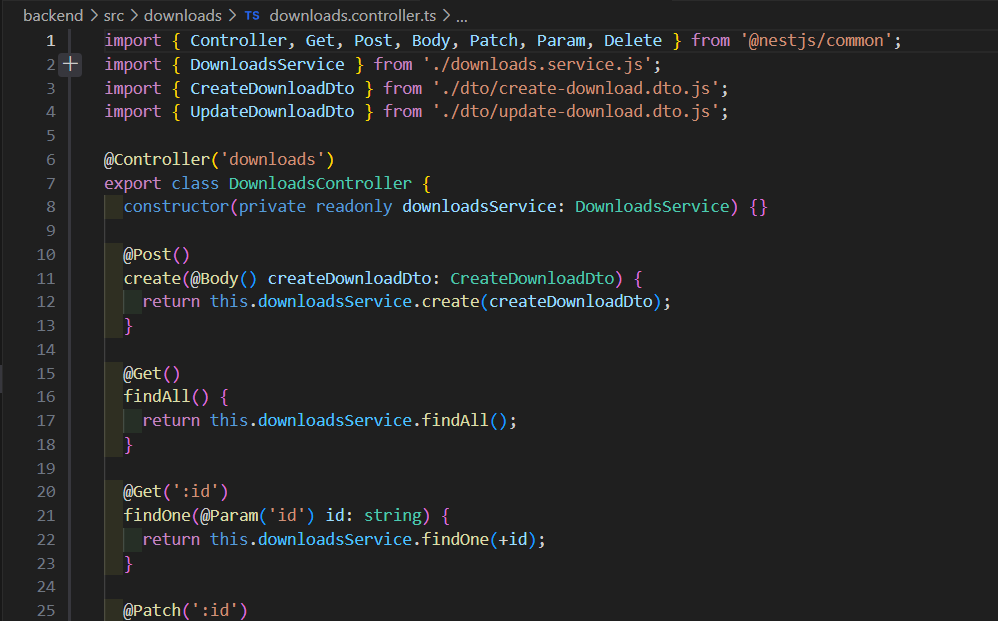
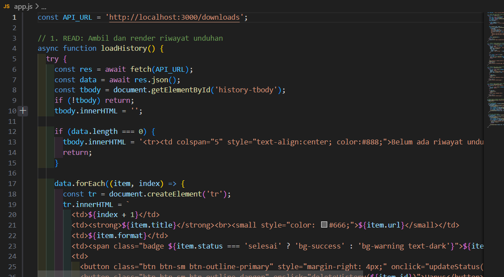
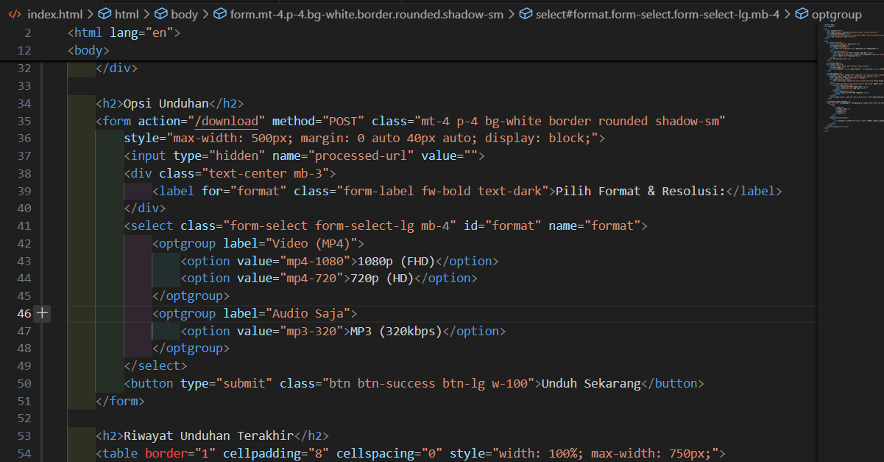

# Tugas Pemrograman Web

**Nama :** Ulung Putra Sadewo  
**NIM  :** 103122400013  

---

## Nama Proyek
**YouTube Downloader**

## Deskripsi Proyek
Aplikasi YouTube Downloader adalah aplikasi web untuk mengunduh video dan audio YouTube dengan berbagai pilihan format serta resolusi (MP4 1080p, MP4 720p, MP3 320kbps). Proyek ini mengintegrasikan frontend web dengan fondasi backend menggunakan **NestJS** berbasis arsitektur **MVC (Model-View-Controller)**. Backend bertugas mengelola entitas utama **Riwayat Unduhan (Download History)** dengan penyimpanan in-memory array, validasi request DTO menggunakan `class-validator`, penanganan error skenario spesifik (`NotFoundException` & `ConflictException`), pengujian lengkap seluruh method HTTP via REST Client, serta integrasi alur penuh CRUD (Create, Read, Update, Delete) ke antarmuka pengguna.

---

## Bagian A: Fondasi Backend & Arsitektur MVC

### 1. Implementasi Controller & Dependency Injection
Implementasi controller untuk menangani routing HTTP (`POST`, `GET`, `PATCH`, `DELETE`) yang memanggil `DownloadsService` melalui *dependency injection* pada constructor.

---

### 2. Inisialisasi Project NestJS
Membuat project backend baru menggunakan perintah `nest new backend` dan memilih `npm` sebagai package manager.

---

### 3. Struktur Direktori Project
Struktur direktori setelah project NestJS berhasil dibuat di dalam sub-folder `backend`, berdampingan dengan file frontend.

---

### 4. Pemilihan Transport Layer Resource
Menjalankan perintah `nest g resource downloads --no-spec` dan memilih tipe transport layer `REST API`.

---

### 5. Konfirmasi CRUD Entry Points
Memilih opsi konfirmasi `Yes` untuk mengenerate fungsi-fungsi dasar CRUD secara otomatis dari Nest CLI.

---

### 6. Resource Downloads Berhasil Dibuat
Output terminal yang menunjukkan modul, controller, service, entity, dan DTO untuk resource `downloads` telah selesai dibuat.

---

### 7. Penyesuaian Entity (`download.entity.ts`)
Mendefinisikan struktur data `Download` dengan 7 field bervariasi (`id`, `title`, `url`, `format`, `fileSizeMb`, `status`, `createdAt`) sesuai kebutuhan data riwayat unduhan.

---

### 8. Penerapan Validasi DTO (`create-download.dto.ts`)
Mengatur aturan validasi data masuk menggunakan decorator dari `class-validator` (`@IsUrl`, `@IsString`, `@MinLength`, `@IsIn`, `@IsNumber`, `@IsOptional`).

---

### 9. Service In-Memory & Penanganan Error Skenario 1
Menginisialisasi array `downloads` di memori serta menangani error menggunakan `ConflictException` (HTTP 409) apabila URL yang diinput sudah ada.

---

### 10. Dependency Injection pada Controller
Konstruktor controller menerima `DownloadsService` secara otomatis melalui dependency injection tanpa membuat instance manual.

---

### 11. Penyimpanan Data Sementara di Memory Service
Inisialisasi data array in-memory di `DownloadsService` sebagai tempat penyimpanan sementara seluruh riwayat unduhan.

---

### 12. Handler Endpoint GET pada Controller
Penerapan decorator `@Get()` untuk mengambil seluruh data unduhan dan `@Get(':id')` untuk mencari unduhan spesifik berdasarkan parameter ID.

---

### 13. Aturan Validasi Input pada Create DTO
Detail kode kelas `CreateDownloadDto` dengan pesan error khusus untuk memastikan URL, format resolusi, dan judul video valid.

---

### 14. Aktivasi Global ValidationPipe & CORS di `main.ts`
Mengaktifkan `ValidationPipe` secara global untuk memvalidasi setiap request yang masuk serta mengaktifkan CORS (`app.enableCors()`) agar backend dapat diakses dari frontend.

---

### 15. Logika Method Create & Exception Duplikasi
Logika method `create()` pada service untuk mengecek keunikan URL sebelum menambahkan item baru dan menghasilkan ID secara dinamis.

---

## Bagian B: Pengujian Endpoint Menggunakan REST Client

### 16. Pengujian GET All Downloads (HTTP 200 OK)
Pengujian endpoint `GET /downloads` untuk mendapatkan seluruh riwayat unduhan yang tersimpan di memori backend. Menghasilkan respon 200 OK dengan data default.

---

### 17. Pengujian POST Create Download Berhasil (HTTP 201 Created)
Pengujian endpoint `POST /downloads` dengan payload valid. Berhasil tersimpan ke array in-memory dengan status 201 Created dan auto-increment ID bernilai 2.

---

### 18. Pengujian Validasi Input Gagal pada DTO (HTTP 400 Bad Request)
Pengujian endpoint `POST /downloads` dengan nilai tidak valid (URL bukan tautan, judul kurang dari 3 karakter, dan format tidak terdaftar). Class-validator berhasil memblokir request dan mengembalikan rincian pesan error dengan status 400 Bad Request.

---

### 19. Pengujian Skenario Duplikasi dengan ConflictException (HTTP 409 Conflict)
Pengujian memasukkan data baru dengan URL yang sudah ada sebelumnya di riwayat. Server memicu `ConflictException` bawaan NestJS dengan pesan error spesifik dan status 409 Conflict.

---

### 20. Pengujian GET Find One by ID (HTTP 200 OK)
Pengujian endpoint `GET /downloads/1` untuk mengambil data riwayat unduhan tunggal berdasarkan ID yang ada. Respon mengembalikan data dengan status 200 OK.

---

### 21. Pengujian Skenario Data Tidak Ditemukan dengan NotFoundException (HTTP 404 Not Found)
Pengujian endpoint `GET /downloads/999` dengan ID yang tidak ada. Server memicu `NotFoundException` dengan pesan "Data unduhan dengan ID 999 tidak ditemukan" (Status 404 Not Found).

---

### 22. Pengujian PATCH Update Download (HTTP 200 OK)
Pengujian endpoint `PATCH /downloads/1` untuk memperbarui atribut format resolusi dan mengubah status unduhan menjadi "selesai". Data berhasil diupdate dengan status 200 OK.

---

### 23. Pengujian DELETE Remove Download (HTTP 200 OK)
Pengujian endpoint `DELETE /downloads/1` untuk menghapus item dari memori. Data berhasil dihapus dengan respon pesan konfirmasi dan rincian data yang dihapus (Status 200 OK).

---

## Bagian C: Integrasi Frontend & Backend

### 24. Implementasi Script Integrasi API (`app.js`)
Pembuatan logic client-side pada `app.js` yang menghubungkan antarmuka frontend ke backend NestJS (`http://localhost:3000/downloads`). Menyediakan fungsi `loadHistory()` untuk fetching data (GET), `createDownload()` untuk menambah riwayat (POST), `updateStatus()` untuk mengubah status menjadi selesai (PATCH), dan `deleteHistory()` untuk menghapus baris riwayat (DELETE).

---

### 25. Penyesuaian Elemen Tampilan Frontend (`index.html`)
Pembaruan struktur `index.html` dengan menambahkan kolom aksi (*Aksi*) pada tabel riwayat unduhan, elemen penampung data dinamis `<tbody id="history-tbody">`, serta menghubungkan file `app.js` sebelum tag penutup `</body>`.

---

## Bagian D: Pengujian Alur Penuh Antarmuka Frontend (Live Web)

### 26. Input URL YouTube pada Frontend (Create - POST)
Memasukkan tautan URL video YouTube baru ke dalam form antarmuka untuk dikirimkan ke backend NestJS.

---

### 27. Riwayat Unduhan Muncul Dinamis pada Tabel (Read & Create Sukses)
Data unduhan baru berhasil ditambahkan melalui method `POST` dan secara reaktif dirender ke dalam tabel riwayat unduhan via pemanggilan `GET`.

---

### 28. Pembaruan Status dan Penghapusan Data (Update - PATCH & Delete - DELETE)
Pengujian alur update dan delete pada tabel: tombol *Tandai Selesai* berhasil memperbarui badge status menjadi hijau (*selesai*) via method `PATCH`, serta tombol *Hapus* berhasil menghapus baris data dari memori backend via method `DELETE`.

